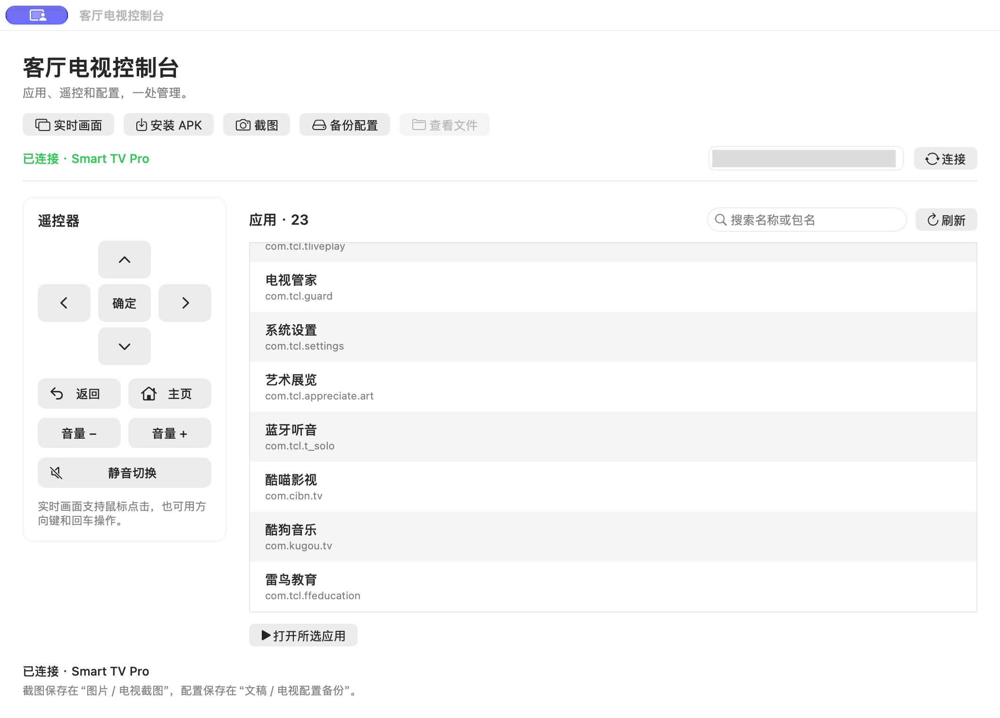

# FFALCON TV Control

雷鸟电视的局域网 ADB 授权研究、macOS 控制台和实时画面工具。项目包含可构建的 Android 诊断应用、首次授权脚本、连接管理、scrcpy 输入补丁和复现文档。

已验证的主要成果：

- 在缺少原生配对入口、没有可用 USB 调试连接的电视上，通过局域网完成原生 ADB 授权，取得 `device` 状态和 `uid=2000(shell)`。
- 通过电脑查看电视实时画面，操作遥控方向键、鼠标点击和桌面滚动。
- 在原生 macOS 控制台中搜索和打开应用、安装 APK、截图、导出 Android 设置及厂商配置。
- 在连接已获授权的前提下发现变化的 ADB 端口，将运行中的服务切换到 `5555`。

## 软件截图与两个应用的关系

“电视控制台”是主入口，负责连接、应用列表、安装 APK、遥控按键、截图和配置备份。“客厅电视”是独立的实时画面窗口，使用 scrcpy 显示电视画面并接收鼠标、键盘输入。点击控制台的“实时画面”即可启动它；两者共用本机连接配置与独立 ADB 密钥，日常打开“电视控制台”即可。

### 电视控制台



### 客厅电视实时画面


## 已验证型号与品牌范围

目前仅在下列一台雷鸟电视上完成实机验证：

| 项目 | 实测环境 |
| --- | --- |
| 电视 | 雷鸟 75S595C Ultra，系统型号 TCL Smart TV Pro |
| 系统 | Android 14 / API 34，MT9655 |
| 固件 | `V8-0015T11-LF1V487.001917` |
| 安全补丁 | 2025-09-05 |
| 屏幕 | 物理 3840×2160，实测逻辑坐标 1920×1080 |
| 电脑 | macOS，Python、ADB、scrcpy 5.0.1 |

| 品牌和型号范围 | 验证状态 |
| --- | --- |
| 雷鸟 75S595C Ultra，上述 V487 固件 | 已验证，功能和限制见[验证记录](docs/validation.md) |
| 雷鸟其他型号或其他固件 | 未测试，不声明支持 |
| TCL 品牌电视 | 未测试，不声明支持；实测设备的系统型号和桌面包名包含 TCL，不能据此推定 TCL 品牌适用 |
| 其他品牌电视 | 未测试，不声明支持 |

特殊授权路径依赖该固件的 `IpelEngine` 配置和系统服务行为。已具备正常 ADB 授权的设备可以跳过特殊授权流程，但这不构成其他设备已经适配的证据；TCL 桌面输入补丁只处理 `com.tcl.cyberui`。安装功能仅验证过同版本诊断 APK 覆盖安装，尚未验证任意第三方 APK 均可安装。

## 开始使用

1. 按[构建说明](docs/build.md)准备工具并构建。
2. 按[快速开始](docs/quick-start.md)创建独立 ADB 密钥和本机配置。
3. 优先使用系统正常授权或无线配对。入口缺失且固件符合实测条件时，参照[固件专用授权流程](docs/adb-authorization.md)。
4. 验证 ADB shell 后打开“电视控制台”，点击“实时画面”。

首次特殊授权会**替换电视已有电脑的 ADB 授权列表**。脚本会恢复原始 `IpelEngine` 配置；旧授权列表无法在该阶段读取备份，配置恢复也不会恢复旧公钥。执行前必须阅读授权文档。

```sh
# 在仓库根目录执行。示例 IP 必须换成电视实际地址。
python3 tools/tvctl.py init --host 192.0.2.10 --port 34961
python3 tools/tvctl.py connect
python3 tools/tvctl.py adb shell id
open .build/apps/电视控制台.app
```

上述连接命令要求该独立密钥已经获得电视授权。首次授权的完整前置步骤见操作文档。

## 文档与源码

| 内容 | 入口 |
| --- | --- |
| 首次连接、日常控制 | [快速开始](docs/quick-start.md) |
| 局域网授权原理、执行与恢复 | [ADB 授权](docs/adb-authorization.md) |
| APK、服务端、macOS 应用构建 | [构建说明](docs/build.md) |
| 组件、权限和输入处理 | [架构](docs/architecture.md) |
| 从固件分析到 shell 验证的研究路径 | [研究记录](docs/research.md) |
| 实机证据、性能与未验证边界 | [验证记录](docs/validation.md) |
| 证书、端口、安装及连接问题 | [故障排查](docs/troubleshooting.md) |
| 配置审计和隐私检查 | [配置与隐私](docs/privacy-and-config.md) |
| 发布和维护 | [贡献指南](CONTRIBUTING.md)、[发布检查](docs/release.md) |
| AI agent 操作约定 | [AGENTS.md](AGENTS.md) |

源码按 Apache-2.0 发布，scrcpy 补丁保留上游授权说明。项目仅包含上述用于展示的真实软件截图，不包含厂商固件、反编译厂商代码、设备密钥、私人屏幕内容或原始诊断导出。普通 ADB TCP 连接不提供 TLS 加密，仅在受控局域网使用，不向公网转发调试端口。
