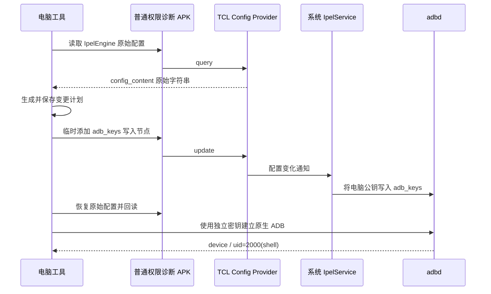

# 固件专用局域网 ADB 授权

## 条件与影响

该流程在雷鸟 75S595C Ultra、Android 14、`V8-0015T11-LF1V487.001917` 上取得过原生 ADB shell。它依赖 `content://com.tcl.providers.config/IpelEngine` 可被普通应用读写，以及系统服务处理 `ipelNode` 的行为。其他固件需要先核查实现和权限，不应直接套用。

执行过程将本机独立 ADB 公钥写入 `/data/misc/adb/adb_keys`。系统服务使用覆盖写入，**已有电脑的授权列表会被替换**。原列表在该权限阶段不可读，无法先备份。恢复配置只能撤回临时节点，无法恢复旧公钥。仍需保留旧电脑的授权时，不执行此流程。

## 原理



诊断 APK 始终以普通应用 UID 运行。获得文件写入权限的是处理配置的系统服务。成功路径无需 root、刷机或进入工厂模式。

## 1. 安装并打开诊断工具

直接下载 [电视调试诊断 v9 APK](https://github.com/iamsyc/ffalcon-tv-control/releases/download/v0.1.0/tv-debug-entry-v9.apk)，无需编译。需要自行构建时运行：

```sh
python3 tools/build.py helper
```

将下载或自行构建的 `tv-debug-entry-v9.apk` 复制到 U 盘，使用电视已有安装入口安装并打开。实测此工具允许安装；不能由此推断所有 APK 均可安装。电视若拦截该 APK，先记录提示，当前流程没有自动解除安装限制的步骤。

在主界面启用“允许电脑操作设置和运行本工具权限内的命令”，保持诊断服务运行。记录页面上的 IP、HTTP 端口和访问路径中的 32 位凭据。主界面显示的 ADB 端口与 HTTP 的 `8765` 是不同服务。

```sh
# init 尚未执行时先创建密钥，端口以电视当前显示为准
python3 tools/tvctl.py init --host 192.0.2.10 --port 34961
python3 tools/tvctl.py helper-config --host 192.0.2.10
python3 tools/tvctl.py helper-status
```

`helper-config` 交互读取路径凭据，保存在本机私有配置。不要将凭据写进 issue、仓库或截图。服务应返回协议版本 `9`，且 `page_control` 为真。无障碍授权页面打不开不阻塞这条路径。

## 2. 生成并核对计划

```sh
python3 tools/tvctl.py authorize-plan
```

此命令只读电视配置，将计划保存为本机 `authorization-plan.json`，权限 `0600`。计划包含原始配置全文、候选配置、电脑公钥及指纹，应保留到验证完成。核对：

- URI 为 `content://com.tcl.providers.config/IpelEngine`。
- 目标为 `/data/misc/adb/adb_keys`。
- 只有一个新增节点，`value` 是本机 `.pub` 文件内容加真实换行。
- 原始 `ipelNode` 内容完整保留，没有已有的 `adb_keys` 节点。

脚本检查配置结构、版本、电脑控制开关及目标内容。结构不一致时停止，转入源码分析；不要为其他固件删掉检查后强行执行。

## 3. 执行授权写入

```sh
python3 tools/tvctl.py authorize-apply --replace-adb-authorizations
```

该显式参数确认替换旧电脑授权。脚本在写入前核对当前配置仍与计划一致，提交临时配置，等待系统服务处理，随后在 `finally` 中恢复原始字符串并精确回读。结果中的 `adb_authorized: unverified` 表示尚未验证原生 ADB。

不要在执行期间退出电脑工具、断网或重启电视。进程被强制结束时，`finally` 无法保证运行，需按下文恢复配置。

## 4. 验证原生连接

```sh
python3 tools/tvctl.py server-restart
python3 tools/tvctl.py connect --port 34961
python3 tools/tvctl.py status
python3 tools/tvctl.py adb shell id
python3 tools/tvctl.py adb shell getenforce
```

将端口替换为电视当前显示值。`server-restart` 只重启配置中的专用电脑 ADB server，使其使用新密钥。`connect` 成功后将服务切至 `5555`。以 `device` 和 `uid=2000(shell)` 为验收标准；若返回 `CERTIFICATE_UNKNOWN` 或 `unauthorized`，授权尚未完成。

历史实测通过了精确配置恢复、独立密钥连接、shell 身份、SELinux Enforcing、断开重连和电脑 ADB server 重启验证。该次记录未覆盖电视重启后的密钥持久性。当前公开封装的脚本经过离线测试，本次整理没有再次对电视执行授权写入。

## 恢复与失败处理

```sh
python3 tools/tvctl.py authorize-restore
# 使用自定义计划文件时
python3 tools/tvctl.py authorize-restore --plan /path/to/authorization-plan.json
```

该命令恢复 `IpelEngine` 原始字符串并回读。若网络中断，先恢复网络和诊断服务，再使用同一计划执行。失败后保留计划，不重新生成计划覆盖原文。

配置恢复与公钥恢复是两个操作。旧 ADB 公钥没有备份，本工具无法撤销已发生的授权列表替换。断开授权可使用电视自身撤销调试授权功能；具体入口取决于固件，实测界面没有提供标准入口。停用调试可关闭电视 ADB 开关。
