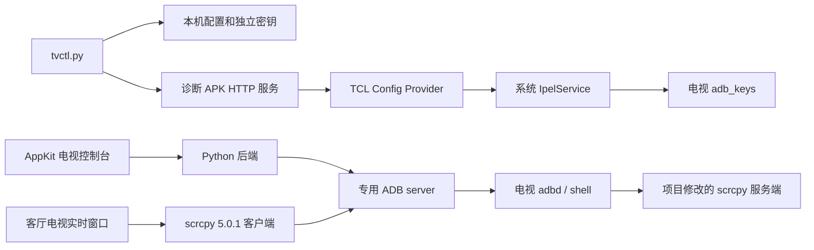

# 架构与权限

## 组件

| 目录 | 职责 |
| --- | --- |
| `android/helper/` | 普通应用诊断、设置入口探测、Provider 读写、本机命令和局域网接口 |
| `tools/authorize.py` | 生成授权计划、临时写入及配置恢复 |
| `tools/tvctl.py` | 本机身份初始化、诊断服务连接、授权和原生 ADB 命令入口 |
| `runtime/tv_connection.py` | CLI、控制台及实时窗口共享的连接管理 |
| `macos/TVConsole.swift` | AppKit UI、应用列表、遥控器和操作结果 |
| `macos/backend.py` | 查询应用、启动、截图、APK 安装和配置导出 |
| `macos/TVControl.py` | 配置 scrcpy 客户端、服务端、密钥及默认画面参数 |
| `patches/` | 相对上游 scrcpy 5.0.1 的最小输入补丁 |
| `tests/device/` | 需要已授权电视的输入和视频实验 |

## 权限分层

诊断 APK 以普通应用 UID 运行。其命令接口不会自动获得 root 或 shell；查询和写入能力取决于目标组件开放的权限。HTTP 路径带随机凭据，设置操作、Provider 操作和命令执行受电视上的电脑控制开关约束。APK 申请的安装权限不等于静默安装权限，局域网更新仍需电视安装器确认。

`IpelEngine` 路径通过系统服务产生写入效果。配置更新返回成功只证明 Provider 接收了更新，原生 ADB 的身份和 shell 回读才证明调试权限已经建立。

获得 ADB 后，scrcpy 服务端由 `app_process` 以 shell 身份启动。TCL 控件点击采用该进程中的 `UiAutomation`，不依赖诊断 APK 的无障碍服务开关。保持已有无障碍服务运行的连接标志为 `1`。

## 输入补丁

实测固件对桌面普通鼠标输入的响应与常规 Android 应用存在差异。补丁识别活动窗口包名 `com.tcl.cyberui`，只在目标主显示屏应用：

- 点击：按下时定位可点击控件，抬起时执行 `ACTION_CLICK`。移动超过 24 个逻辑像素时取消点击，避免拖动误触。
- 垂直滚动：将滚轮序列合并为方向键按下、重复和抬起，交给桌面自身动画处理。累计阈值为 `0.2`，重复间隔至少 80 ms，最后事件后 120 ms 释放。
- 方向改变、其他按键、触摸开始和服务关闭时释放滚轮按键，避免遗留长按。

其他应用、横向滚动和不满足补丁条件的输入继续走上游 scrcpy 原有路径。补丁没有替换桌面，没有降低系统安全补丁等级。

## 连接与文件

`connection.json` 保存电视地址、ADB 可执行文件及密钥路径。`helper.json` 保存诊断 HTTP 地址和凭据。两者放在用户支持目录，文件权限为 `0600`，不写入仓库。`TV_CONTROL_HOME` 可以为终端和开发测试指定另一个状态目录；Finder 启动的应用默认使用标准用户支持目录。

共享模块根据状态目录和密钥内容生成服务标识，在系统临时目录中使用当前用户私有的 Unix socket，避免多个项目争用固定 TCP 端口。同一配置和身份共用服务，不同配置或密钥分别启动服务。

ADB 子进程的 `HOME` 指向状态目录中的 `adb/<服务标识>/`，其中 `.android/adbkey` 链接到原私钥。主进程和用户终端的 `HOME` 保持原值，外部 `ADB_VENDOR_KEYS` 不传给 ADB。此处保留原密钥，不复制或生成替代身份。

每次 ADB 调用前读取 `server-status` 的 `keystore_path`，确认服务使用该身份目录。路径不符时停止，不接管或终止该服务。原生 ADB 透传和 scrcpy 也使用同一环境；私钥缺失时直接报错。ADB 的默认用户密钥加载方式见[上游实现](https://android.googlesource.com/platform/packages/modules/adb/+/refs/heads/main/client/auth.cpp)。

连接顺序为 `5555`、保存端口、同 IP 的 ADB mDNS 广播。只有实际取得 `device` 状态后才切换电视端口。端口切换属于已授权 shell 操作，不构成首次授权。

控制台 APK 安装先上传随机名称的临时文件，再执行 `pm install -r`。上传和安装都在同一个 `try/finally` 中，上传异常、超时或安装失败后仍会尝试删除临时文件；连接持续中断时，删除也可能失败并返回错误。该方式避开实测固件上流式安装的 ABB 等待问题。配置备份只读导出 Android 三个设置命名空间、厂商配置和系统属性。
